# macOS ASIF image MVP

This experiment runs a real macOS guest from an existing container macOS image,
commits its changed disk blocks as an OCI image, and boots a reconstructed
instance. It leaves the installed runtime, existing containers and cluster
configuration unchanged. Linux guests are outside its scope.

The host must run macOS 27 on Apple silicon. The guest can run macOS 26.
[DiskImageKit](https://developer.apple.com/documentation/diskimagekit) supplies
the native layered disk attachment. The build machine needs the macOS 27 SDK;
the test host does not need Xcode 27. Guest build tests need Xcode and CMake.

```mermaid
flowchart LR
    A[Existing OCI macOS image] --> B[Private stopped Disk.img copy]
    B --> C[Immutable RAW base]
    C --> D[Per-instance writable ASIF]
    D --> E[Guest build and sync]
    E --> F[Stop owned VM]
    F --> G[OCI manifest: base + sealed ASIF + VM identity]
    G --> H[Validate and reconstruct]
    H --> I[Readonly base + readonly ASIF + new writable ASIF]
    I --> J[Boot guest and verify build outputs]
```



## Build and run

The `macOS ASIF image MVP` workflow produces Developer ID signed
`macos-asif-runner` and `macos-asif-raw-import` binaries, checksums, signing details
and compiler provenance. The runner uses SDK 27; the RAW adapter uses Xcode 26.3
and the existing RAW import library. These are experimental executables, not a
notarized node release. Keep the runner
beside `image.py` or supply `--runner /absolute/path/macos-asif-runner`.
Python 3 and `zstd` must be installed on the host. Use absolute canonical paths.

The input directory must be a **stopped, dedicated copy** containing `Disk.img`,
`HardwareModel.bin`, `MachineIdentifier.bin`, and `AuxiliaryStorage`. Confirm the
source is not a live runtime. The tool checks open handles before cloning. It
uses APFS clones; running and importing still consume additional physical space.
Reserve at least 20 GiB for writes and sufficient capacity for a cold base import
and compressed blobs. A large source image can require considerably more.

```sh
mkdir -m 700 /private/var/tmp/image-cache
python3 image.py init /absolute/stopped-source /absolute/raw --backend raw
python3 image.py init /absolute/stopped-source /absolute/asif --backend asif
python3 image.py run /absolute/asif /absolute/build.sh
python3 image.py commit /absolute/asif /absolute/oci-image --cache /private/var/tmp/image-cache
python3 image.py restore /absolute/oci-image /absolute/restored --cache /private/var/tmp/image-cache
python3 image.py run /absolute/restored /absolute/verify.sh
```

`run` starts one VM with four CPUs, 8 GiB memory and no networking. Build inputs must already be present in the dedicated test image. The script runs
as root through the existing guest-agent protocol on vsock port 27000; use `su`
inside the script for an ordinary build user. Only trusted local scripts are
supported. Output is retained as framed JSON in the private instance directory.
The wrapper waits for guest `sync` after the script and stops its own VM before
allowing a commit. A failed or timed-out run prevents commit. It does not preserve
memory, running processes or GUI sessions.

## Image and cache contract

The v1 OCI artifact binds the ordered RAW base, ASIF layer and VM identity files
by SHA-256 and size. The v2 experiment retains the existing RAW disk-layout and
sparse tar+zstd chunks for the base, with ASIF only for changed disk blocks. The
manifest includes every base chunk; the decoded base cache is keyed by the bound
layout digest, not a caller-supplied base label. Both versions reject missing,
reordered or changed content before finalizing an instance. Installed image
clients do not yet read either experimental format.

Content acquisition verifies compressed blobs once. A private content-store
receipt binds each immutable blob to its validated inode, size and modification
metadata; changed or foreign content falls back to SHA-256 validation. Cold
reconstruction reuses that acquisition result, matching the current RAW import
boundary. Copying an artifact to another machine invalidates these receipts and
requires content verification there. Cold imports reserve the recorded base allocation,
four parallel chunk temporaries and 20 GiB of headroom before creating an instance.
Decoded caches are independent of content
verification: an empty decoded cache still reconstructs the base.

The private cache stores immutable files and their validated inode, size, mode
and modification metadata. Cache hits avoid a full base scan at every boot.
Changed cache files fail closed. This assumes one trusted local owner; it is not
a cache shared across security domains. Locks prevent this tool from running,
committing or importing into the same instance/cache concurrently. There is no
automatic cache eviction or background cleanup.

The MVP supports one derived image: base + sealed ASIF + active ASIF, at most
three disk layers while running. Further image commits are rejected until a
flattening path is implemented. Default restoration preserves VM identity for
an offline checkpoint. `restore --new-identity` creates a new machine identifier
for a separate test instance; this is not a general image sanitization workflow.

## Layer-depth experiment

The separate `run-depth` diagnostic accepts 2 through 9 total disk layers and
uses explicit uncached host storage. The image import/commit commands retain
their three-layer limit. Every measurement starts a fresh, networkless guest
with 4 vCPUs and 8 GiB. No global host cache purge is needed.

Prepare two dedicated, stopped RAW inputs of equal size: a baseline and a final
reference containing the fixed project and random-read dataset. `layer_depth.py`
compares every logical byte, records differing 1 MiB blocks, and distributes those
same blocks across each stack's ASIF layers. It attaches only private cloned
images with `diskutil image attach --noMount`, verifies the returned virtual
device's identity and size before writing, and ejects that device afterward.
Each completed stack must match the final reference's full-disk SHA-256.

```sh
python3 layer_depth.py scan /private/base.img /private/final.img /private/diff.json
python3 layer_depth.py build /private/base.img /private/final.img /private/diff.json 9 /private/chain-9
./macos-asif-runner inspect-depth /private/chain-9
python3 layer_depth.py measure /private/chain-9 /private/identity /private/sample-9 \
  /absolute/macos-asif-runner /private/measure.sh
```

Build `random-read.c` inside the reference guest. `prepare FILE BYTES` exclusively
creates deterministic data; `read FILE THREADS OPERATIONS SEED` performs verified
4 KiB reads using `F_NOCACHE` and reports IOPS and latency percentiles. Repeat the
same seeds and operation counts for each layer depth. Host caching is explicitly
uncached; controller caches and metadata caches are not globally flushed.

Clone a completed chain and identical VM identity files for each sample. Rotate
depth order and record first admin output, two random-read passes at queue depths
1 and 16, and the fixed Xcode clean/incremental/reuse workload. The constructor's
full-disk scan and all OCI transfer are outside this runtime comparison. Keep
failed fixtures and logs; remove successful sample disk clones only after the
VM stopped acknowledgement and closed-handle checks. `measure` retains its
instance for this explicit cleanup.

## Guest build measurement

`benchmark.py` runs as `admin` inside the test guest. It verifies zstd revision
`f8745da6ff1ad1e7bab384bd1f9d742439278e99` (v1.5.7) against the pinned source
archive checksum, generates an Xcode project, and records clean, incremental and
no-change build times. It also verifies compression/decompression with the built
binary. No network is used to fetch dependencies during measurement.

Before cloning the two test instances, place the pinned source tarball and
`benchmark.py` in `/Users/admin/MVPInput` in the private, stopped source image.
Use the existing image build workflow or mount only that private source copy,
copy the files to its Data volume, and unmount it before cloning. The files must
be readable by the guest admin user. A guest script invokes the benchmark:

```sh
set -eu
su -l admin -c '/opt/homebrew/opt/python@3.13/libexec/bin/python3 /Users/admin/MVPInput/benchmark.py prepare'
```

Run `prepare` once on each backend, then alternate RAW/ASIF boots running
`measure --sample N`. Use identical guest resources, source, toolchain and sample
numbers. After committing and restoring, run `verify` to compare source and
binary checksums and execute the restored binary. Report startup, build,
publication and reconstruction separately, including cold versus cached base
handling. Small sample counts establish pilot results, not production percentiles.

Host-side integrity tests:

```sh
python3 -m unittest discover -s scripts/macos-asif-mvp -p 'test_*.py' -v
```

## Restore comparison

Compare three decoded-cache states independently: no cached disk, only the
parent disk cached, and the complete target image cached. Keep OCI blobs local
for this experiment and report transfer costs separately. A cold-versus-warm
comparison of one backend does not measure a format speedup.

`MacOSImageRestoreExperimentTests` is an opt-in timing harness for the production
RAW `MacOSDiskRebuilder` and `FilesystemClone` path. Prepare a private, owned
directory containing `layout.json`, verified OCI blobs under `oci/blobs/sha256`,
the three VM identity files under `identity`, and `request.json` with distinct
`sample` and `cache` directory names. The harness is disabled unless
`MACOS_IMAGE_RESTORE_EXPERIMENT` points to that directory:

```sh
MACOS_IMAGE_RESTORE_EXPERIMENT="$EXPERIMENT_ROOT" \
  swift test -c release --filter MacOSImageRestoreExperimentTests
```

The harness records disk reconstruction and clone times and creates a private
RAW instance that the signed runner can boot. Use a fresh cache for the cold
sample, the same cache for target-image hits, and a separate parent cache when
measuring a new derived image. The existing RAW cache is keyed by the complete
image, so a decoded parent does not avoid rebuilding a new target image.

For each backend, also boot the prepared instance, run a command as the normal
guest user, and verify restored files and executable output. Report disk
preparation and preparation-to-first-user-command separately; neither metric
includes scheduling, network download or desktop readiness. Include any import
validation within the measured restore path. The legacy v1 ASIF cold importer rechecks compressed blobs and serially decodes
and hashes the full logical disk. The v2 importer uses the same parallel sparse
`MacOSDiskRebuilder` as RAW. Keep content acquisition verification outside the
materialization comparison for both backends; a real network measurement must
include it.

## Chunked RAW base experiment

Build the experimental adapter with the repository toolchain (SDK 27 is not
required for this disk-only helper):

```sh
swift build -c release --product macos-asif-raw-import
```

Prepare an owned, mode-0700 directory with an immutable, idle `Disk.img` clone.
The opt-in `MacOSChunkExportExperimentTests` calls the existing RAW chunker and
writes `chunks/layout.json` and `chunks/blobs/sha256`. Set
`MACOS_CHUNK_EXPORT_EXPERIMENT` to that directory to run it. An optional
`MACOS_CHUNK_PARENT_EXPERIMENT` points to a previously verified chunks directory
and exercises the existing parent-blob reuse path.

Before using the export, verify the source clone stayed unchanged and its full
SHA-256 matches the immutable base in the instance. Verify each exported blob's
filename digest, make it readonly, then write `chunks/binding.json` containing
`sha256` (the verified base digest), `layoutStamp` (`image.stamp(layout.json)`),
and `blobs` (a map from `sha256:<digest>` to `image.stamp(blob)`). This receipt is
created by the trusted fixture exporter; arbitrary caller-authored bindings are
not a production image trust mechanism. Do not remove the source while verifying.

```sh
python3 image.py commit /absolute/asif /absolute/oci-v2 \
  --cache /absolute/publication-cache --base-chunks /absolute/export/chunks
python3 image.py restore /absolute/oci-v2 /absolute/restored \
  --cache /absolute/decoded-cache \
  --raw-importer /absolute/repository/.build/release/macos-asif-raw-import
```

A cold v2 import verifies the bound layout and its chunk inventory, invokes the
production RAW rebuilder, and decodes only the small ASIF/identity files through
the experimental decoder. Target-cache hits clone the validated base and layer;
parent-cache hits reconstruct only the new ASIF layer. A failed reconstruction
cannot finalize a runnable instance or a validated base-cache receipt. A failed
instance directory remains available for inspection; retry into a fresh private
directory. The adapter and exporter are validation tools and are not installed
by the node release packaging.

Production adoption still requires runtime/OCI format negotiation, image ancestry
and GC integration, bounded flattening, encrypted TOS archive integration, power
failure testing and sustained guest workload acceptance. This experiment does
not change Suspend, Resume or the production image format.
